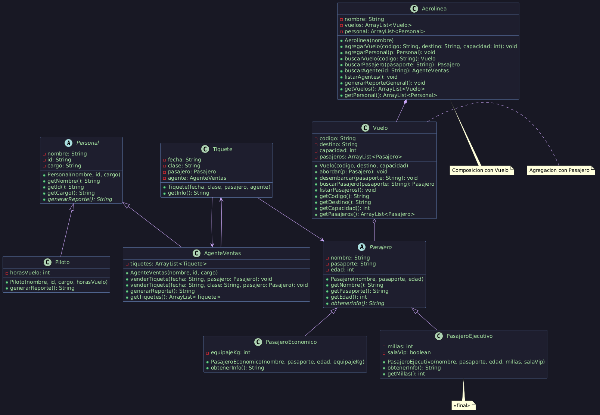

## Getting Started

Welcome to the VS Code Java world. Here is a guideline to help you get started to write Java code in Visual Studio Code.

## Folder Structure

The workspace contains two folders by default, where:

- `src`: the folder to maintain sources
- `lib`: the folder to maintain dependencies

Meanwhile, the compiled output files will be generated in the `bin` folder by default.

> If you want to customize the folder structure, open `.vscode/settings.json` and update the related settings there.

## Dependency Management

The `JAVA PROJECTS` view allows you to manage your dependencies. More details can be found [here](https://github.com/microsoft/vscode-java-dependency#manage-dependencies).

Desición del grupo:

### Búsqueda de pasajeros (opciones 4 y 8)

El método `buscarPasajero` de `Aerolinea` solo encuentra pasajeros que ya
abordaron un vuelo, porque recorre la lista de pasajeros de cada `Vuelo`.

se exige abordar primero (opción 3) ya que:

- Un pasajero que solo está registrado (opción 1) pero no ha abordado ningún
  vuelo no se puede buscar (opción 8) ni se le puede vender un tiquete (opción 4).
  En ese caso se lanza `PasajeroNoEncontradoException`.
- Si un pasajero desembarca (opción 7), sale del vuelo y debe volver a abordar
  para poder buscarlo o venderle otro tiquete.
- `pasajerosRegistrados` es una lista temporal en `App` y solo se usa para
  listar los registrados (opción 2) y para abordar (opción 3).

seguimos el pseudocódigo del taller, donde `buscarPasajero`pertenece a `Aerolinea` y delega la búsqueda en cada `Vuelo`, manteniendo la
lógica de búsqueda dentro del modelo y no en `App`.

Integrantes del grupo
- Rachell Quintero.
- Juanita Rodriguez.
- Tatiana Valenzuela.

Diagrama UML.
